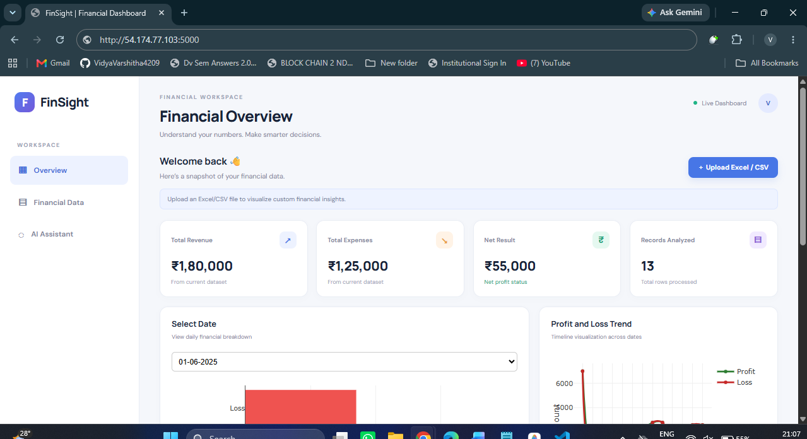
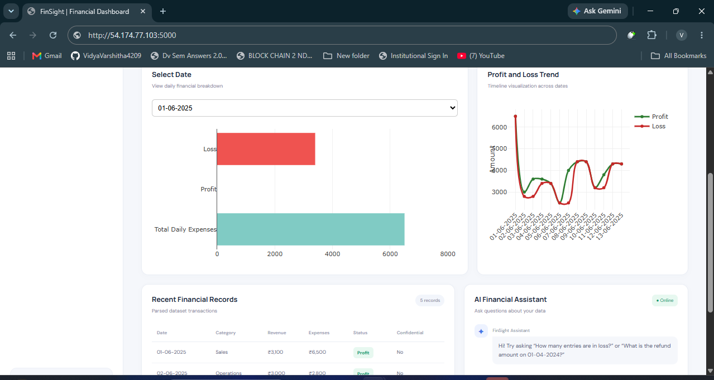

# FinSight — Financial Dashboard

A Flask-based financial dashboard that provides a simple interface to explore financial records, visualize sample profit/loss trends, upload CSV or Excel data, and ask basic questions about the uploaded dataset.

## Dashboard Screenshots

### 1. Financial Overview


### 2. Financial Dashboard — Additional View


## Features

- Dashboard interface built with HTML, CSS, and JavaScript
- Sample daily financial charts using Plotly
- Upload CSV and Excel (`.xlsx` / `.xls`) files
- Calculate total revenue, expenses, and net result on the backend
- Basic dataset Q&A for loss, confidential, refund, and summary queries
- A scikit-learn text-classification model and saved vectorizer

## Tech stack

- **Frontend:** HTML, CSS, JavaScript, Plotly.js
- **Backend:** Python, Flask
- **Data processing:** pandas
- **Machine learning:** scikit-learn (Multinomial Naive Bayes, CountVectorizer)
- **Input formats:** CSV and Excel

## Project structure

```text
financial_dashboard/
├── app.py
├── train_model.py
├── model.pkl
├── vectorizer.pkl
├── requirements.txt
├── README.md
├── .gitignore
├── templates/
│   └── index.html
└── static/
    ├── script.js
    └── style.css
```

## Run locally

1. Install Python 3.10 or newer.
2. Open a terminal in this project folder.
3. Create and activate a virtual environment (recommended).

   **Windows**
   ```powershell
   python -m venv .venv
   .venv\Scripts\activate
   ```

4. Install dependencies:

   ```bash
   pip install -r requirements.txt
   ```

5. Start the Flask server:

   ```bash
   python app.py
   ```

6. Open `http://127.0.0.1:5000` in your browser.

To stop the server, press `Ctrl+C` in the terminal.

## Retrain the sample model (optional)

The repository includes `model.pkl` and `vectorizer.pkl`. To recreate them from the small sample dataset in `train_model.py`, run:

```bash
python train_model.py
```

Run the command from the project root so the generated files are saved where `app.py` expects them.

## Input data notes

The upload endpoint expects a CSV or Excel file. For the financial summary calculations, columns named `Revenue` and `Expenses` are used (column names are normalized by the app). If these columns are missing, the current backend fills them with zero values.

The current model is trained on a very small illustrative text dataset. Treat its classifications as a demonstration, not as a validated financial prediction system. Do not upload real confidential financial information to a public deployment.

## Current implementation notes

- The dashboard charts initially use sample data defined in `static/script.js`.
- The upload route returns processed rows and summary values, but the current frontend does not yet update every summary card and table from the returned response.
- The chatbot uses rule-based keyword matching; it is not connected to a generative AI service.
- Plotly.js is loaded from a CDN, so the browser needs internet access to load the chart library.


